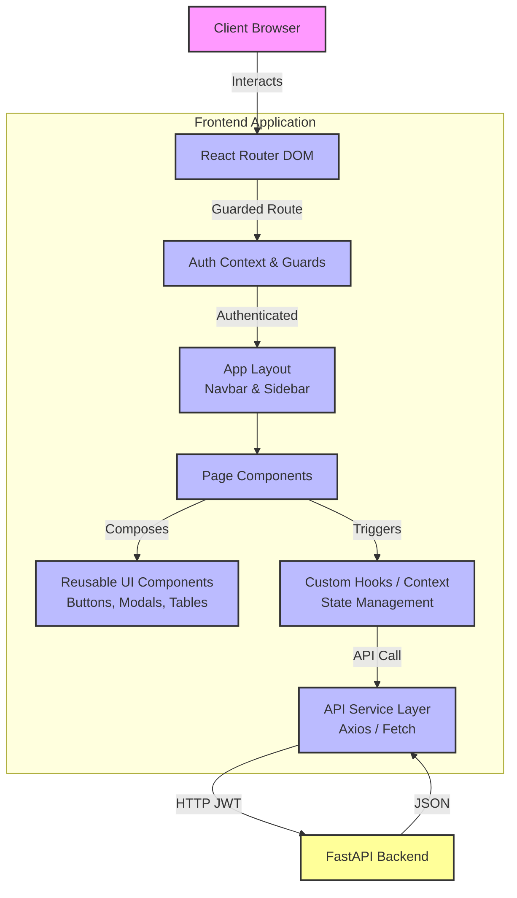
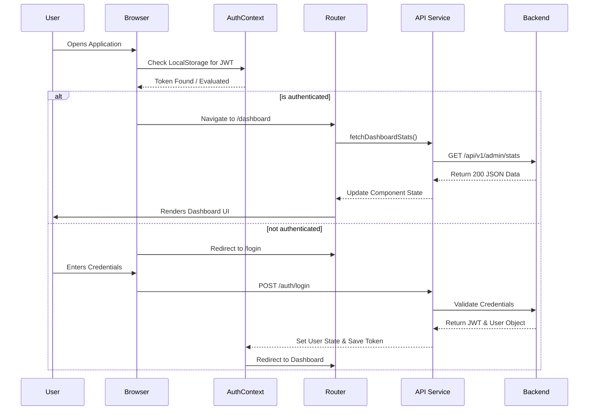
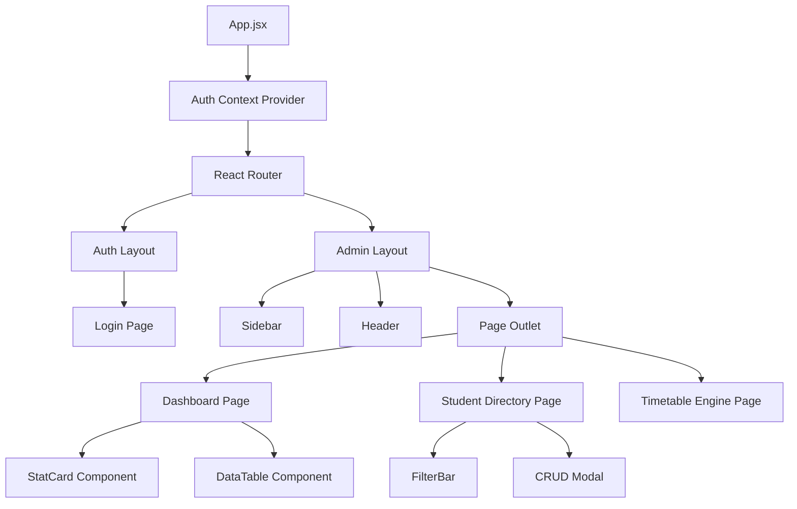
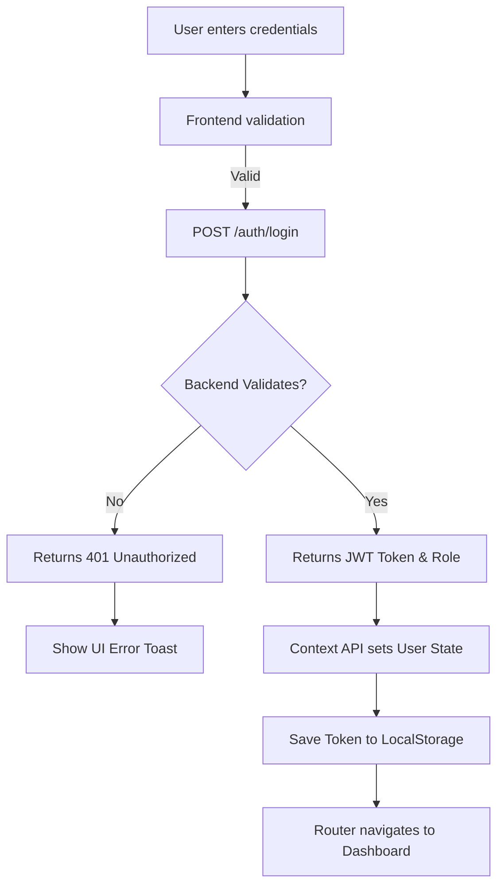
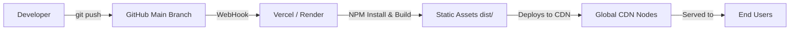

<div align="center">


# Student Attendance Management System - Web Portal

### "A Powerful, Modern, and Scalable Web Solution for Institutional Attendance & Analytics"

An enterprise-grade, highly responsive web dashboard for administrators and faculty to seamlessly manage students, faculty, timetables, and real-time attendance analytics.

<p align="center">
  <a href="#"></a>
  <a href="#"></a>
  <a href="#"></a>
  <a href="#"></a>
  <a href="#"></a>
</p>

<p align="center">
  <a href="#"></a>
  
  
  
</p>

[**Live Demo**](#) • [**GitHub Repository**](https://github.com/Santhanamsk02/Attendance_Frontend) • [**Backend Repository**](#)

</div>

---

## Project Overview

Managing institutional attendance, faculty assignments, and complex overlapping timetables requires a robust, high-performance system. 

This **Frontend Web Portal** is engineered to provide a lightning-fast, highly secure, and visually stunning administrative dashboard. Built with React and Vite, it handles complex data grids, interactive calendar overrides, and heavy statistical charting with zero lag, ensuring that administrators and teachers have total oversight at their fingertips.

| Category | Details |
|---|---|
| **Purpose** | Institutional Data & Attendance Management |
| **Users** | College Administrators, Department Heads, Faculty |
| **Platform** | Modern Web Browsers (Chrome, Safari, Firefox, Edge) |
| **Performance** | Optimized rendering with React Memo and Vite Build |
| **Design** | Glassmorphism UI powered by Tailwind CSS |

---

## Key Features

### Authentication & RBAC
- **Secure Login:** JWT-based stateless authentication.
- **Role-Based Access Control:** Distinct dashboard experiences for Admins vs. Teachers.
- **Route Guards:** Robust protection of sensitive administrative endpoints.

### Real-Time Dashboard & Analytics
- **Live Metrics:** Total students, faculty, departments, and active classes.
- **Data Visualization:** Interactive charts for attendance trends.
- **Recent Activity:** Real-time tables tracking latest attendance logs.

### Comprehensive Entity Management
- **Student Directory:** Pagination, search, filtering, and bulk import capabilities.
- **Teacher Roster:** Manage faculty profiles, assignments, and verification statuses.
- **Subject Catalog:** CRUD operations for institutional curriculum.

### Advanced Timetable & Scheduling
- **Dynamic Grids:** Visual calendar UI for assigning teachers to subjects/periods.
- **Calendar Overrides:** Specialized logic to handle holidays or custom day-order schedules.

### Premium UI/UX & Responsive Design
- **Glassmorphism Components:** Modern, translucent layouts.
- **100% Mobile Responsive:** Fluid scaling across phones, tablets, and massive desktops.

---

## ️ Frontend System Architecture



---

## Application Flow



---

## Frontend Architecture

This web application utilizes a strict modular, component-based architecture for supreme scalability.

| Layer | Responsibility | Technologies |
|---|---|---|
| **UI Layer** | Presentation and visual aesthetics | `Tailwind CSS`, `Lucide React` |
| **Components** | Atomic, highly reusable generic UI blocks | `React Functional Components` |
| **State** | Application state and global variables | `React Context API`, `Custom Hooks` |
| **API Service** | Dedicated HTTP client classes | `Fetch / Axios instances` |
| **Security** | Route protection and token injection | `React Router Guards` |

---

## Component Architecture



---

## ️ Technology Stack

| Technology | Purpose | Why Used |
|---|---|---|
| **React** | Core Library | Unmatched component architecture and ecosystem. |
| **Vite** | Build Tool | Blazing fast HMR (Hot Module Replacement) and optimized builds. |
| **Tailwind CSS** | Styling | Utility-first CSS for rapid, highly custom UI development. |
| **Context API** | State Management | Native React solution preventing prop-drilling without Redux bloat. |
| **React Router** | Routing | Industry-standard declarative routing and layout nesting. |
| **Lucide React** | Icons | Crisp, lightweight, highly customizable SVG icons. |

---

## Project Structure

```text
src/
├── components/          # Reusable React components
│   ├── common/          # Layouts, Headers, Sidebars, Modals
│   ├── dashboard/       # Dashboard specific widgets and charts
│   ├── students/        # Student tables, forms, and filters
│   └── timetable/       # Complex grid rendering components
├── context/             # Global React Contexts (Auth, Toast, Theme)
├── hooks/               # Custom React hooks (useDebounce, useTimetable)
├── layouts/             # Master layout wrappers (AdminLayout, TeacherLayout)
├── pages/               # Top-level route components
│   ├── admin/           # Admin restricted pages
│   ├── auth/            # Login and verification pages
│   └── teacher/         # Teacher restricted pages
├── services/            # API communication modules
├── utils/               # Helper functions and formatters
├── App.jsx              # Main React Application shell
└── main.jsx             # React DOM entry point
```

---

## API Integration Architecture

The frontend communicates with the backend via isolated Service modules. Each logical domain (Auth, Students, Timetable) has its own dedicated service file containing async fetch wrappers.

```javascript
// Example: src/services/studentService.js
import api from './api';

export const studentService = {
  // GET Request
  getStudents: async (params) => {
    const response = await api.get('/api/v1/students', { params });
    return response.data;
  },
  
  // POST Request
  createStudent: async (studentData) => {
    const response = await api.post('/api/v1/students', studentData);
    return response.data;
  }
};
```

---

## Authentication Flow



---

## UI/UX Design Philosophy

- **Glassmorphism:** Heavy utilization of `backdrop-blur` and translucent white backgrounds to create a premium, depth-rich interface.
- **Micro-Interactions:** Subtle hover states, transition-all animations, and active scaling on buttons to provide tactile feedback.
- **Empty States & Skeletons:** Beautifully designed empty states and pulsing shimmer skeletons to prevent jarring UI shifts during data loading.

---

## Responsive Design

This web portal is strictly designed mobile-first, gracefully expanding to utilize massive desktop real-estate.

| Device | Screen Size | Layout Support |
|---|---|---|
| **Mobile** | `< 768px` | Hidden Sidebar (Hamburger Menu), Stacked Tables |
| **Tablet** | `768px - 1024px` | Collapsed Icons-only Sidebar, Responsive Grids |
| **Desktop** | `> 1024px` | Full Expanded Sidebar, Multi-column Data Panels |

---

## Performance Optimization

- **React Router Lazy Loading:** Code-splitting routes so users only download the JavaScript they need for the page they are viewing.
- **Custom `useDebounce` Hooks:** Drastically reduces API spam when typing in search and filter inputs.
- **Vite Build Optimization:** Treeshaking and minification applied automatically during `npm run build`.

---

## ️ Installation & Setup

### 1. Clone Repository
```bash
git clone https://github.com/Santhanamsk02/Attendance_Frontend.git
```

### 2. Navigate to Project
```bash
cd Attendance_Frontend
```

### 3. Install Dependencies
```bash
npm install
```

### 4. Configure Environment Variables
Create a `.env` file in the root directory:
```env
# The base URL of your FastAPI backend
VITE_API_BASE_URL=http://localhost:8000
```

### 5. Start Development Server
```bash
npm run dev
```

---

## Production Build

To build the application for a production environment:

```bash
npm run build
```
*This generates a heavily optimized, minified `dist/` directory ready to be served by Nginx, Vercel, Netlify, or Render.*

To preview the production build locally:
```bash
npm run preview
```

---

## Deployment



---

## Contributing

1. Fork the Project
2. Create your Feature Branch (`git checkout -b feature/AmazingFeature`)
3. Commit your Changes (`git commit -m 'Add some AmazingFeature'`)
4. Push to the Branch (`git push origin feature/AmazingFeature`)
5. Open a Pull Request

---

## Developer

**Name:** Santhanam  
**Role:** Full-Stack Engineer  
**GitHub:** [Santhanamsk02](https://github.com/Santhanamsk02)  
**LinkedIn:** [Your LinkedIn Profile](#)  

---

## License

Distributed under the MIT License. See `LICENSE` for more information.

---

<div align="center">
  <i>If you found this dashboard useful, please consider giving the repository a !</i>
</div>
